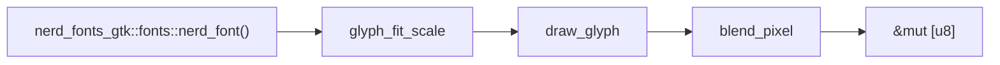

# Architecture

## Crate Structure

```
pixel-drawing/
├── src/
│   ├── lib.rs              # Module declarations and re-exports
│   ├── render_context.rs   # Builder pattern for multi-element renders
│   └── drawing/
│       ├── mod.rs          # Module declarations and re-exports
│       ├── pixel.rs        # fill_background, blend_pixel, draw_text_bitmap
│       ├── glyph.rs        # draw_glyph, glyph_fit_scale, truncate_text_to_width
│       ├── icons.rs        # draw_nerd_font_icon, draw_icon_placeholder, draw_icon_grid
│       ├── text.rs         # draw_label_text, draw_text_centered
│       └── progress.rs     # draw_progress_bar, default_text_color
├── examples/
│   └── interactive_demo.rs # GTK4 demo showing all rendering functions
└── book/                   # mdBook documentation
```

## Design Principles

### No Windowing System Required

All rendering functions operate on raw `&mut [u8]` RGBA pixel buffers. This
makes the library suitable for headless rendering, texture generation, and
embedded use cases.

### Font Dependency

`pixel-drawing` delegates font loading to `nerd-fonts-gtk`:
- `nerd_font()` — Nerd Font for icon glyphs
- `label_font()` — Label font for text rendering

This separation keeps font bundling and loading logic in one place while
`pixel-drawing` focuses on pixel-level rendering.

### Alpha Blending

All glyph and text rendering uses alpha blending via `blend_pixel`. Source
pixels are composited over destination pixels with per-pixel alpha coverage
from `ab_glyph`'s outline rasterizer.

### Caching

`glyph_fit_scale` uses a `thread_local` cache keyed by `(GlyphId, target_px)`
to avoid redundant glyph probing on repeated renders of the same icon at the
same size.

## Data Flow



1. Font is loaded via `nerd_font()` (cached in `nerd-fonts-gtk`)
2. `glyph_fit_scale` computes the em-scale for a target pixel size
3. `draw_glyph` rasterizes the glyph outline with `ab_glyph`
4. `blend_pixel` composites each pixel with alpha blending
5. Result is written directly into the caller's pixel buffer
