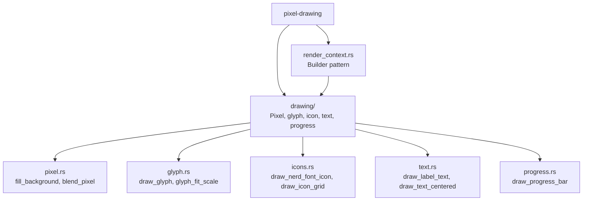

# Introduction

**pixel-drawing** is a Rust library for software rendering onto raw RGBA pixel
buffers. It provides glyph rasterization, icon rendering, text layout,
progress bars, and a builder-pattern render context — all without requiring a
windowing system or GPU. Colors use the generic `Color<T>` type from
`smearor-commons-color` (`Color<f64>` normalized, `Color<u8>` pixel-native).

## What Does It Do?

- **Pixel Operations** — `fill_background`, `blend_pixel`, and a bitmap text
  fallback renderer
- **Glyph Rendering** — Single-glyph rasterization with alpha blending using
  `ab_glyph`, plus glyph-to-pixel scale computation with caching
- **Icon Rendering** — Draw Nerd Font icons by name or codepoint, icon
  placeholders, and icon grids
- **Text Rendering** — Draw label text at the bottom of an image or centered
  text at arbitrary positions, with font fallback chains and truncation
- **Progress Bars** — Horizontal progress bar rendering with configurable
  colors
- **RenderContext** — Builder pattern that combines background fill, icon
  drawing, and label text into a single fluent API

## Module Overview

## Dependency on nerd-fonts-gtk

`pixel-drawing` depends on [nerd-fonts-gtk](https://github.com/smearor/nerd-fonts-gtk)
for font loading (`nerd_font()`, `label_font()`) and icon name resolution
(`IconName`, codepoint maps). The `render` feature enables this dependency.

## License

MIT. See [LICENSE](https://github.com/smearor/pixel-drawing/blob/main/LICENSE).
